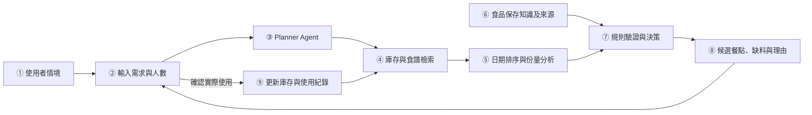
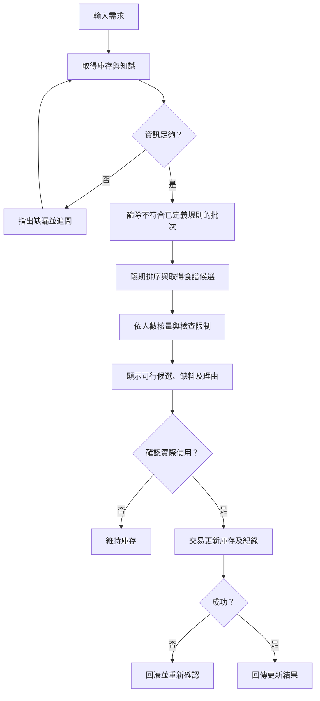

# Food Guardian — Project Design

本文件為研究提案設計，對應本次 DESIGN → OpenSpec workflow 作業；內容均為規劃。

## 1. 目標與需求

目標使用者為管理家庭食材的成員。系統預計整合 AI Agent、庫存、食品保存知識與資料分析，提供有依據的餐點候選與使用順序。

| ID | 需求 | 預期行為 |
| --- | --- | --- |
| FR-01 | 庫存透明 | 以批次記錄名稱、數量、單位、日期、開封狀態及保存方式 |
| FR-02 | 日期與資訊檢查 | 日期提醒與保存風險分開；資料不足先追問 |
| FR-03 | 庫存優先推薦 | 依人數核量，顯示缺料與不可換算單位 |
| FR-04 | 硬限制檢查 | 排除不符合已定義保存規則或使用者排除條件的項目 |
| FR-05 | 可解釋輸出 | 顯示使用批次、需求量、現有量、來源與推薦理由 |
| FR-06 | 確認後更新 | 使用者確認實際用量後才更新；取消不異動 |
| FR-07 | 可驗證評估 | 固定情境、參考日期與比較條件，保留評估依據 |

## 2. System Architecture



① 定義家庭與用餐情境；② 收集人數、偏好及限制；③ LLM 負責理解與協調；④ 取得實際資料；⑤ 以程式計算；⑥ 保留保存規則適用條件與來源；⑦ 核對硬限制；⑧ 揭露不確定性；⑨ 紀錄實際使用及丟棄，供後續分析。

## 3. Flowchart



## 4. Data / AI / Domain Knowledge

庫存欄位：批次 ID、食材名稱、數量、單位、入庫日期、標示日期與類型、開封狀態、保存方式、更新時間。食譜欄位：基準人數、必要食材、份量、單位與來源。知識欄位：規則 ID、適用條件、來源、查閱日期及版本。

預計採 Python、Streamlit、SQLite、Pandas 與 JSON 知識庫。LLM 透過白名單工具檢索及協調；份量、排序與規則檢查交由確定性程式處理，不以模型文字代替驗證。保存資訊不足時追問，不由 LLM 補造。日期提醒僅供管理，不能證明食品實際安全。

需求量＝食譜量 × 目標人數／基準人數。僅在可確認的同維度單位間換算；包／盒與重量關係未知時標記待確認。使用者偏好不能覆蓋硬限制。

## 5. Algorithm 1：Proposed Food Guardian Workflow

```text
Input: query Q, inventory I, recipes R, knowledge K, servings N
Output: candidates, shortages, explanations and confirmed inventory changes
01: Validate query, servings and required fields
02: Retrieve inventory batches and relevant knowledge with sources
03: Identify missing dates, storage information and ambiguous units
04: If information is insufficient: ask clarification and return to 02
05: Exclude batches that violate defined rules
06: Sort remaining batches by applicable date and entry time
07: Retrieve or generate candidate recipes
08: For each candidate, scale requirements by target servings
09: Convert quantities only when the unit relationship is known
10: Check stock quantities, excluded ingredients and hard constraints
11: Mark shortages and unknown conditions explicitly
12: Present candidates with batch quantities, reasons and sources
13: Wait for confirmation of actual use
14: If cancelled: return without inventory changes
15: Begin database transaction
16: Validate current balance and duplicate operation identifier
17: If validation or update fails: rollback and request confirmation
18: Otherwise update stock and insert usage/waste record
19: Commit transaction
20: Return updated inventory and traceable records
```

## 6. 評估規劃

預計建立 20–30 種食材、20–30 道食譜、30 組情境（庫存充足、缺料、日期與保存、資訊缺漏、偏好與互動，各 6 組）。比較一般 LLM、取得相同庫存與規則的 LLM，以及 Food Guardian；主要以後兩組比較工具流程的效果。

指標包括食譜可行率、庫存匹配率、日期提醒準確率、規則違反率、可行解覆蓋率及澄清行為。標準答案須先人工建立及覆核；本作業不以模擬規劃宣稱真實減廢效果。

## 7. 轉換至 OpenSpec

| 設計內容 | OpenSpec capability | 驗收情境 |
| --- | --- | --- |
| A–F、5／3／10、緒論與文獻 | proposal-documentation | 章節齊全、引用可追溯、預期成果不冒充結果 |
| FR-01～FR-07、流程與演算法 | food-guardian-workflow | 資訊缺漏、不可換算、缺料、取消與更新失敗 |

變更文件見 openspec/changes/001-refactor-project-proposal/，操作與驗證見 [OpenSpec workflow](docs/openspec-workflow.md)。
