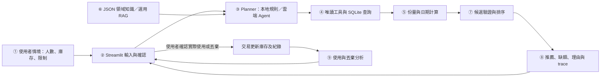
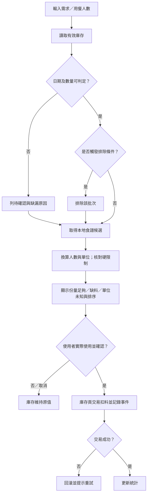

# Food Guardian 系統設計與實作
更新：2026-11-17。單一家庭、本機課程原型。來源與授權見 [THIRD_PARTY.md](THIRD_PARTY.md)。

## 1. Problem 與範圍
系統連接家庭庫存、日期提醒、食譜候選與使用紀錄，讓使用者知道「有哪些食材、哪些接近標示日期、指定人數缺多少」。研究假設為：外部數量與限制檢查能改善推薦可執行性；真實減廢效果尚未驗證。

本次沿用參考專案的 SQLite、Streamlit、Agent 與測試模組，再補規格、離線操作入口、資料缺漏處理與驗證。參考 repo 的測試數字不作為本專案結果。

## 2. Requirements
| ID | 需求 | 驗收與實作 |
| --- | --- | --- |
| FR-01 | 食材新增、編輯、查詢及刪除錯誤輸入 | 正數、有限數量、合法單位與日期；InventoryService |
| FR-02 | 使用與丟棄分開記錄 | 不超額扣料、交易同時寫入事件，取消不寫入 |
| FR-03 | 日期提醒 | 今日至門檻日包含邊界，無日期獨立呈現 |
| FR-04 | 指定人數核對 | 依比例換算；g/kg、ml/l 可換算，包與重量不可推定 |
| FR-05 | 保守篩選 | Use By 過期排除；Best Before 過期與日期缺漏待確認 |
| FR-06 | 排序與排除食材 | 現有食材優先／臨期優先／綜合；排除名單不產生候選 |
| FR-07 | 工具可追溯 | AI 回應附工具 trace；工具白名單唯讀 |
| FR-08 | 分析與可重現性 | 各食材各單位分組統計，固定日期評估，API 失敗獨立記錄 |

非功能要求：不公開金鑰與個人資料庫；雲端模式明確選用；離線無 API 可操作；未知資料不可推定；失敗不得靜默冒充成功。資料庫日期為 YYYY-MM-DD；目前執行日期沿用系統本地日期，部署應設為 Asia/Taipei；固定測試日期不受系統時間影響。

## 3. System Architecture

① 家庭為單一使用範圍；② 人數與排除食材以明確欄位輸入；③ 離線關鍵字路由與真正 LLM 工具呼叫分開標示；④ Agent 不取得任意 SQL 或寫入工具；⑤ 數值由 Python 計算；⑥ 示範知識與官方來源分開；⑦ 預先篩選、逐項核量；⑧ 各道料理獨立計算，不能同時承諾共享庫存；⑨ 只統計已記錄事件。

## 4. Flowchart

原型不會依聊天內容自動扣料；每筆實際用量在庫存頁確認。多批次的自動分配與整餐原子扣料仍屬後續功能。

## 5. Data 與介面
- inventory_items：id（批次）、name、category、quantity、unit、purchase_date、expiry_date、date_label_type、opened_date、storage_location、status、建立／更新時間。
- consumption_waste_logs：批次連結與名稱／單位快照、數量、consumed／wasted、原因、日期。刪除錯誤庫存時保留歷史快照。
- recipes.sample.json：示範食譜、基準人數、食材需求量、單位、步驟；不是營養師或廚師驗證的資料。
- food_knowledge.sample.json：示範保存知識；rag_documents 包含來源欄位，標記 verified 不代表本次已完成引用人工審查。
- evaluation/cases.json：沿用來源的 30 組情境、6 類各 5 題；與早期提案「5 類各 6 題」不同。LLM 品質與領域正確性仍需獨立人工審核。
- data/demo_inventory.json：合成示範庫存；載入時以執行日期平移，不以舊日期假裝現況。

工具輸入／輸出詳見 src/agent/agent_core.py 與 gemini_graph.py；recommend_for_servings 回傳 ingredient_requirements、缺額、unknown、excluded_items、can_make_now 及排序理由。未知單位不轉換，無日期不自動選用。

## 6. AI / Analytics / Domain Knowledge
離線模式以關鍵字選工具，食譜核量由確定性 Python 完成；不稱為 LLM 推理。OpenAI 模式使用唯讀 function calling；Gemini 模式使用 LangGraph，需額外安裝 requirements-ai.txt。ChromaDB RAG 需安裝 requirements-rag.txt 及自行建索引，本次未執行 embedding 下載或 Live 檢索。

保存檢查是日期與已知狀態的初步分組，不是食安認證。日期未知為 review，Use By 過期為 blocked，Best Before 過期為 review；示範知識的保存天數不自動產生期限。冷鏈、開封時長、來源衝突與臺灣產品規則尚未完整形式化，eligible 僅代表未觸發既定阻擋條件。

份量：需求量 = 食譜量 × 目標人數 / 基準人數；缺額 = max(0, 需求量 − 可換算有效庫存量)。分數 = 0.65 × 足量項目比例 + 0.35 × 臨期優先度。分數為排序設計，非信心度。排除食材依名稱與既有別名匹配，不能保證過敏原或交叉接觸安全。

## 7. Algorithm 1：Food Guardian
Input：需求 Q、目標人數 N、庫存 I、食譜 R、排除清單 X、參考日期 D
Output：候選、缺料／待確認原因、工具紀錄；確認後之庫存事件
```text
01: Validate N in [1,12], allowed units and input dates
02: Retrieve active inventory I from SQLite
03: For each batch in I:
04:   If inactive, invalid quantity or known spoiled: mark blocked
05:   Else if date missing: mark review and request clarification
06:   Else if past Use By: mark blocked
07:   Else if past Best Before or label unknown: mark review
08:   Else mark eligible under defined preliminary rules
09: Load source-labelled local demonstration recipes R
10: Remove recipes containing explicitly excluded ingredients X
11: For each recipe r in R:
12:   Scale required quantities by N / base_servings
13:   Sum eligible quantities only within the same unit dimension
14:   Preserve unconvertible stock as unknown
15:   Compute missing quantities and sufficient flags
16:   Calculate date urgency and quantity coverage
17: Rank by selected mode; retain missing/unknown warnings
18: Present candidates independently with evidence and limitations
19: Wait for user's actual consumption/waste confirmation on inventory page
20: If cancelled: return without mutation
21: Begin SQLite IMMEDIATE transaction
22: Validate operation ID, current status and available quantity
23: If repeated identical operation: return original success
24: If conflict, insufficient balance or write failure: rollback
25: Otherwise deduct quantity and insert event and operation receipt
26: Commit transaction and refresh inventory
27: Aggregate recorded events by ingredient and unit
28: Return results; do not infer household waste reduction
```

## 8. Implementation Mapping
| 模組 | 程式 | 主要驗證 |
| --- | --- | --- |
| 庫存與交易 | src/services/inventory_service.py、database/schema.sql | tests/test_inventory_transactions.py |
| 日期提醒 | src/services/reminder_service.py | tests/test_inventory_transactions.py |
| 核量、篩選、排除 | src/services/portion_service.py | test_portion.py、test_recommendation_safety.py |
| Agent | src/agent/agent_core.py、gemini_graph.py | test_agent_core.py、test_gemini_graph.py |
| 統計 | src/services/analytics_service.py | test_inventory_transactions.py |
| UI | src/ui/app.py、components/ | test_ui_smoke.py |
| 評估 | evaluation/run_evaluation.py | evaluation/results/、test_evaluation_core.py |

## 9. How to Run 與 OpenSpec
安裝、離線資料載入、AI 選用、測試及 Demo 步驟見 README。
設計轉規格：本檔需求 → openspec/specs 的 SHALL 與 Scenario → change 的 tasks → 對應程式與測試 → validation／結果紀錄。完整操作見 [OpenSpec workflow](docs/openspec-workflow.md)。

## 10. Results 與 Limitations
本機驗證結果見 [VALIDATION.md](docs/VALIDATION.md)。不沿用參考 repo 的 Live 成績；沒有新 API 實測、RAG groundedness、人工 reference labels 或家庭減廢試驗結果。30 組評估中來源 metadata 檢查與真正檢索不同，多工具雲端項目離線為 NOT_RUN。

原型缺少多使用者權限、實際溫度監測、完整開封後規則、聊天多輪狀態一致性、整餐自動分配與已核實在地食安規則。最終 PPT、YouTube 影片與家庭試驗需依實際展示及參與者資料完成，不能以自動測試取代。
