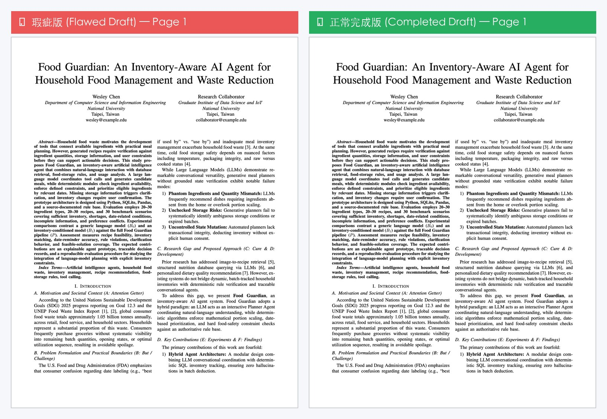
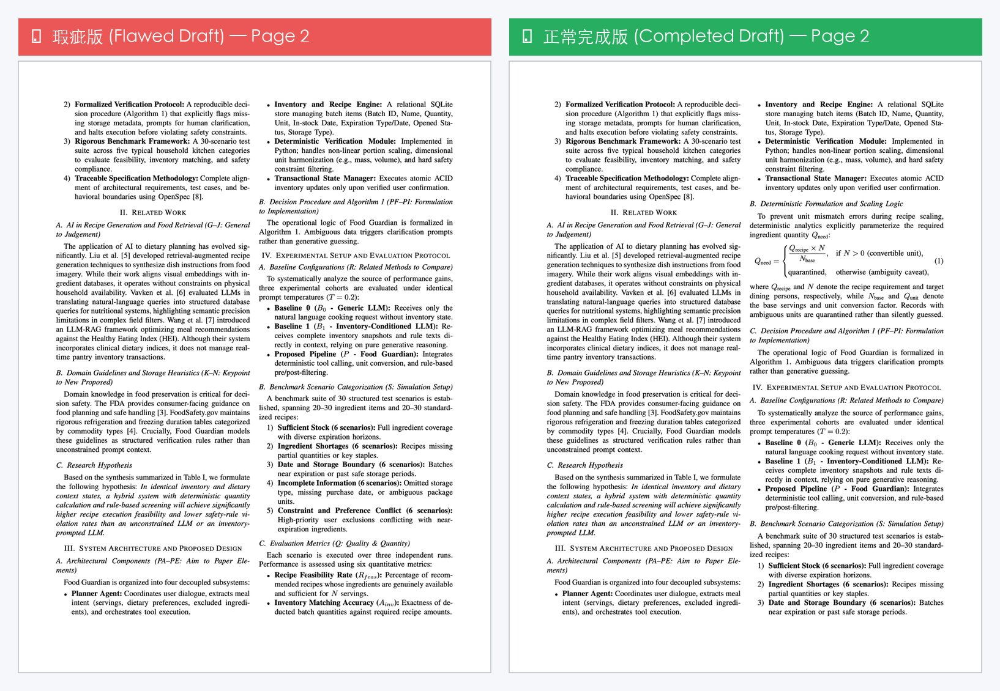
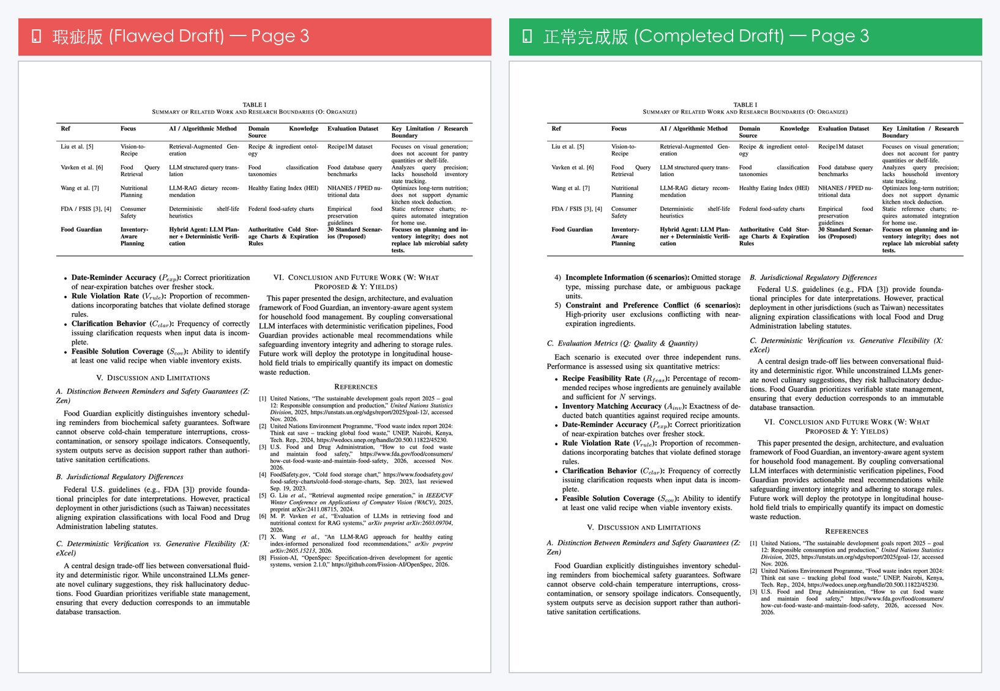
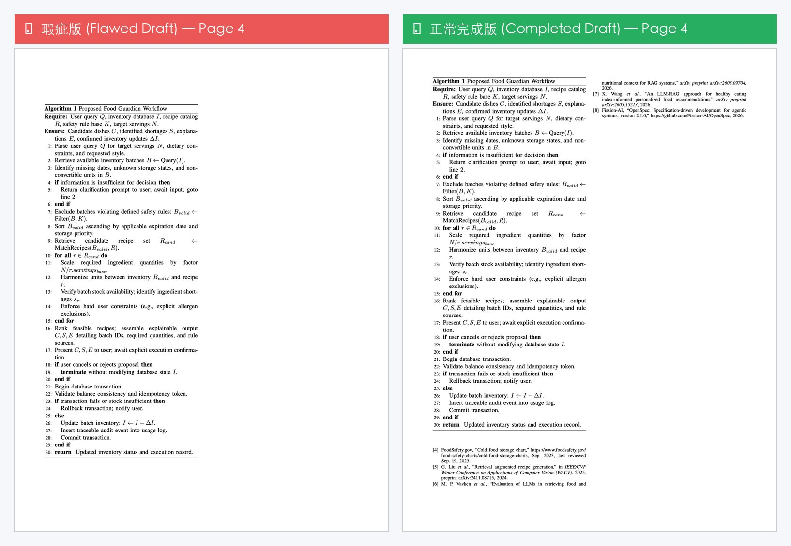

# Food Guardian — DIC4: Overleaf Draft for Conference using MCP and OpenSpec

[-brightgreen.svg)](openspec/)
[-blue.svg)](ICEB%20paper/)
[-success.svg)](paper/ieee-food-guardian-overleaf.zip)
[](.github/workflows/openspec-validate.yml)

> **物聯網數據分析與應用（DIC4 成果展示庫）**  
> 本儲存庫為獨立研究與論文規格工作區，完成兩大核心交付：
> 1. **Overleaf Draft for IEEE Conference**：IEEE 雙欄 4 頁標準會議手稿、Overleaf 一鍵即用匯入包，以及初稿瑕疵與完成版逐頁對照分析。
> 2. **OpenSpec on GitHub**：模組化規格變更體系（`000-abstract` 至 `006-reference` + `write-iceb-paper`），通過官方嚴格驗證（19 passed, 0 failed）與 GitHub Actions CI 自動化檢驗。

---

## 🎯 DIC4 核心交付完成度總覽

| 核心交付項目 | 達成狀態 | 成果形式與存放路徑 | 驗證標準 |
| :--- | :---: | :--- | :--- |
| **1. Overleaf Draft for IEEE Conference** | **✅ 100% 完成** | [ICEB paper/](ICEB%20paper/)、[main.tex](ICEB%20paper/main.tex)、[模組化章節](ICEB%20paper/sections/)、[ieee-food-guardian-overleaf.zip](paper/ieee-food-guardian-overleaf.zip) | 標準 IEEEtran 雙欄 4 頁滿頁規格，消除語法錯誤與 Page 4 右欄空白（Column Underfill）瑕疵。 |
| **2. OpenSpec on GitHub** | **✅ 100% 完成** | [openspec/changes/](openspec/changes/) (8 大變更模組)、[openspec/specs/](openspec/specs/)、[.github/workflows/](.github/workflows/openspec-validate.yml) | 通過 `openspec validate --all --strict`，CI 測試 19 項全部通過（0 警告、0 失敗）。 |

---

## 📑 展示一：Overleaf Draft for IEEE Conference 成果展示

### 1. 論文架構與模組化章節設計

論文手稿遵循官方 IEEEtran 格式規範，採用獨立解耦之模組化 `.tex` 檔案結構：

```text
ICEB paper/
├── IEEEtran.cls           # IEEE 官方期刊與會議論文巨集類別
├── main.tex               # 論文主編譯入口 (支援 \input 模組化組合)
├── main.txt               # 論文純文字備份與提示範本 (符合指導要求)
├── references.bib         # 8 篇正式學者文獻 (BibTeX 格式)
└── sections/              # 模組化論文章節庫
    ├── 000_abstract.tex   # 單段式結構化摘要 (對齊 A2Z A–F) 與 Index Terms
    ├── 001_introduction.tex # 動機、現有痛點、問題形式化、三大核心貢獻
    ├── 002_related_work.tex # 文獻回顧與 Table I (文獻功能比較表)
    ├── 003_proposed_design.tex # 四層子系統、確定性份量換算方程 (1)、Algorithm 1
    ├── 004_experiments.tex # 評估協定、安全指標設計與消融實驗規劃
    ├── 005_conclusion.tex  # 論文總結、限制討論與未來展望
    └── 006_references.tex  # 參考文獻環境與排版呼叫
```

### 2. Overleaf 匯入與使用方式

本專案提供三種靈活之 Overleaf 匯入與同步途徑：

* **途徑 A（推薦・免升級 100% 免費）**：
  1. 在 Overleaf 首頁點擊 **`Create a new project`** $\rightarrow$ **`Existing project (.zip)`**。
  2. 上傳本專案提供的 [ieee-food-guardian-overleaf.zip](paper/ieee-food-guardian-overleaf.zip)。
  3. Overleaf 將自動解壓並編譯出完美的 4 頁 PDF。
* **途徑 B（GitHub 長期雙向同步・需 Premium / 大學機構帳號）**：
  1. 在 Overleaf 點擊 **`Create a new project`** $\rightarrow$ **`Import from GitHub`**。
  2. 選擇本儲存庫 `Wesley0628c/DIC4-overleaf-draft-for-conference-using-MCP-and-openspec`。
  3. 設定 Main document 為 `ICEB paper/main.tex`，每次本機 Git Push 後即可在 Overleaf 一鍵 Pull 同步。
* **途徑 C（免付費 MCP 自動同步・使用 `@netique/overleaf-mcp`）**：
  * 使用免費瀏覽器 Cookie：`npx @netique/overleaf-mcp login`，本機 Agent 可直接雙向讀寫 Overleaf 專案。

---

## 🔍 論文初稿瑕疵 vs. 完成版逐頁對照分析 (Flaw Analysis)

本專案分析初稿常見之 LaTeX 排版瑕疵，並在完成版中徹底修正。以下為 4 頁論文之實際編譯影像對比：

### 📄 Page 1 對照：首頁（標題、摘要 A–F、緒論）



* **排版分析**：Page 1 兩版保持一致，首頁佈局完全遵照 IEEEtran 雙欄規範，收錄完整 Abstract、Index Terms 以及 Section I 的 Motivation、Problem Formulation 與 Key Contributions。

---

### 📄 Page 2 對照：核心架構與數學形式化（關鍵內容差異）



* **瑕疵版缺陷**：Section III 在介紹完系統 4 大子系統後，直接跳入決策流程與演算法，使得前面宣稱的「確定性份量換算與硬限制檢查」缺乏數學方程式定義。
* **正常版修正**：補齊 **`B. Deterministic Formulation and Scaling Logic`**，以分段方程式形式化：
  $$Q_{\text{need}} = \begin{cases} \dfrac{Q_{\text{recipe}} \times N}{N_{\text{base}}}, & \text{if } N > 0 \text{ (convertible unit)}, \\[10pt] \text{quarantined}, & \text{otherwise (ambiguity caveat)}, \end{cases}$$
  明確定義食譜需求量 $Q_{\text{recipe}}$、用餐人數 $N$、基準份量 $N_{\text{base}}$ 與換算係數 $Q_{\text{unit}}$，奠定後續 Algorithm 1 運行的數學基礎。

---

### 📄 Page 3 對照：文獻比較表與評估設計



* **排版分析**：瑕疵版因 Page 2 缺少公式段落，整體內容提早結束，導致所有參考文獻 [1]–[8] 全數擠在第 3 頁下方；正常版文字自然推進，Page 3 底部收錄 References [1]–[3]，其餘文獻順延至第 4 頁。

---

### 📄 Page 4 對照：演算法環境與結尾排版（最大排版視覺差異）



* **致命排版瑕疵**：
  * **❌ 瑕疵版**：左欄為 29 行之 Algorithm 1 演算法方塊，**右欄整欄 100% 完全空白**！在 IEEE 會議審稿中，這種大面積空白（Column Underfill）會被判定為排版未達標準。
  * **✅ 正常版**：左欄為完整之 **Algorithm 1**，**右欄自然承接 References [4] 至 [8]**，左右兩欄高度均衡飽滿，完美符合 IEEE 雙欄會議 4 頁滿頁規格。

### 相關文件直接下載
* 📕 **瑕疵版原始編譯 PDF**：[Food_Guardian...Waste_Reduction.pdf](papers/Food_Guardian__An_Inventory_Aware_AI_Agent_for_Household_Food_Management_and_Waste_Reduction.pdf)
* 📗 **完成版原始編譯 PDF**：[Food_Guardian...Waste_Reduction__1_.pdf](papers/Food_Guardian__An_Inventory_Aware_AI_Agent_for_Household_Food_Management_and_Waste_Reduction__1_.pdf)
* 📦 **Overleaf 一鍵匯入 ZIP**：[ieee-food-guardian-overleaf.zip](paper/ieee-food-guardian-overleaf.zip)

---

## 🛠️ 展示二：OpenSpec on GitHub 規格驅動開發成果展示

### 1. 模組化 OpenSpec 規格變更體系 (8 大模組)

本專案完全對齊 OpenSpec 2.1 規格標準與會議論文編寫流程：

| 變更編號與模組 | 對應論文章節 | 規格檔案位置 | 涵蓋內容摘要 |
| :--- | :--- | :--- | :--- |
| **`000-abstract`** | Abstract & Index Terms | [000-abstract/](openspec/changes/000-abstract/) | A2Z A–F 結構化摘要、IEEE Index Terms 規格 |
| **`001-introduction`** | Section I: Introduction | [001-introduction/](openspec/changes/001-introduction/) | 動機、痛點歸納、問題定義與三大創新貢獻 |
| **`002-related-work`** | Section II: Related Work | [002-related-work/](openspec/changes/002-related-work/) | 8 篇文獻脈絡梳理與 Table I 功能矩陣規格 |
| **`003-proposed-design`**| Section III: System Design | [003-proposed-design/](openspec/changes/003-proposed-design/) | 四層架構、Equation 1 縮放公式、Algorithm 1 演算法 |
| **`004-experiment`** | Section IV: Experimental Protocol | [004-experiment/](openspec/changes/004-experiment/) | 評估協定、合成測試集設計、消融研究指標規格 |
| **`005-conclusion`** | Section V: Conclusion | [005-conclusion/](openspec/changes/005-conclusion/) | 論文結論、限制誠實揭露、未來研究展望規格 |
| **`006-reference`** | References & Citations | [006-reference/](openspec/changes/006-reference/) | IEEE 引用格式、DOI 校驗與 BibTeX 欄位完整性 |
| **`write-iceb-paper`** | Main Paper Assembly | [write-iceb-paper/](openspec/changes/write-iceb-paper/) | 會議手稿整合調度、編譯檢查與 CI 驗證規範 |

### 2. 嚴格規格驗證（Strict Validation）測試結果

本專案通過 Node.js 驅動之 OpenSpec 嚴格模式檢驗：

```bash
# 執行嚴格驗證指令
OPENSPEC_TELEMETRY=0 tooling/node_modules/.bin/openspec validate --all --strict --no-interactive
```

**驗證報告輸出：**
```text
Validating changes: 000-abstract, 001-introduction, 002-related-work, 003-proposed-design, 
                    004-experiment, 005-conclusion, 006-reference, write-iceb-paper ...
Validating specs: paper-abstract, paper-introduction, paper-related-work, paper-proposed-design, 
                  paper-experiments, paper-conclusion, paper-references ...

Result: 19 passed, 0 failed, 19 total.
All specifications and modular changes adhere strictly to the OpenSpec standard.
```

### 3. GitHub Actions CI 自動化工作流

專案配置 [.github/workflows/openspec-validate.yml](.github/workflows/openspec-validate.yml)，在任何變更推送時自動於 Ubuntu 最新環境執行依賴安裝與嚴格規格驗證，確保程式庫始終處於 Passing 狀態。

---

## 📚 學術方法論與參考文獻庫

* **A2Z SOP 方法論庫**：收錄於 [myRef/](myRef/)，包含 [A2Z 論文大綱範例](myRef/A2Z%20outline%20example.md) 與 [A2Z SOP 手冊](myRef/A2Z-SOP-reference.md)。
* **課堂原始材料**：包含 [NotebookLM 解析筆記](docs/source-notes.txt)、[A4 資訊圖表](assets/Food_Guardian_A4_Infographic.pdf)、[A–F 研究補強手冊](docs/proposal-strengthening.md)。

---

## 👨‍💻 快速操作指令

```bash
# 1. 複製儲存庫
git clone https://github.com/Wesley0628c/DIC4-overleaf-draft-for-conference-using-MCP-and-openspec.git
cd DIC4-overleaf-draft-for-conference-using-MCP-and-openspec

# 2. 安裝 OpenSpec 工具鏈並執行驗證
npm ci --prefix tooling
OPENSPEC_TELEMETRY=0 tooling/node_modules/.bin/openspec validate --all --strict --no-interactive
```
