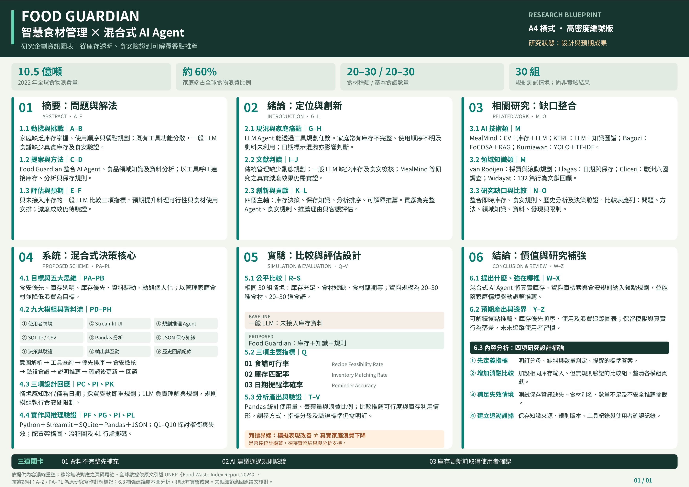

# Food Guardian

智慧食材管理與家庭食物浪費減量 AI Agent 研究企劃。

本專案提出結合 AI Agent、食品領域知識與資料分析的智慧食材管理系統，整合庫存查詢、臨期食材排序、食譜推薦及保存風險檢查，協助家庭將現有食材轉化為可行餐點。

目前內容包含研究摘要、第二部分研究補強、IEEE 風格英文摘要、企劃來源筆記及 A4 資訊圖表。系統實作與實驗評估尚屬規劃，預期成果不代表已完成驗證。

## 第一部分：專題解析與 A4 資訊圖表

依 A–Z 論文架構整理 Food Guardian 的研究動機、挑戰、解法、方法、評估及預期成果，並製作 A4 資訊圖表。

- [NotebookLM 原始解析筆記](docs/source-notes.txt)
- [A4 資訊圖表 PDF](assets/Food_Guardian_A4_Infographic.pdf)
- [A4 資訊圖表 PNG](assets/Food_Guardian_A4_Infographic.png)

原始解析時未取得獨立的《期末專題規範.pdf》，仍需補做規範對照；筆記中的未核實文獻不能直接當作正式引用。

## 第二部分：研究補強與中文摘要

補充官方報告與相關研究，整理 A–F、五大核心、三項取捨、十項設計問答、研究貢獻及可驗證的評估方法，再濃縮為約 300 字中文摘要。

- [完整研究補強與文獻比較](docs/proposal-strengthening.md)
- [約 300 字中文摘要](docs/abstract-300zh.md)
- [原有約 500 字摘要](docs/abstract.md)

研究補強附上來源連結，區分既有證據、研究假設與預期成果；保存規則的臺灣適用性仍須在實作時逐項核對。

## 第三部分：IEEE 風格英文摘要

以英文標題（Title）、單段摘要（Abstract）及關鍵字（Index Terms）呈現 Food Guardian 的研究問題、系統方法、評估規劃與預期貢獻。

- [IEEE 風格英文標題、摘要與關鍵字](docs/abstract-ieee.md)

目前為提案階段，英文摘要使用提案時態，未宣稱已取得實驗結果；正式投稿時需再核對目標期刊的格式要求。

## 規劃技術

| 項目 | 技術或方法 |
| --- | --- |
| 系統開發 | Python |
| 使用者介面 | Streamlit |
| 資料儲存 | SQLite |
| 資料分析 | Pandas |
| 推薦與規劃 | 具 Tool Calling 能力的 LLM Agent |
| 食品保存知識 | JSON 知識庫與規則檢查 |

## 實驗規劃

建立 20–30 種常見食材、20–30 道基本食譜與 30 組測試情境，與未整合真實庫存的一般 LLM 食譜推薦進行比較。評估食譜可行率、庫存匹配率與日期提醒準確率，並分析食材使用量、丟棄量及浪費比例。

## 資料說明

原始筆記保留原貌，其中的文獻名稱與統計不應直接作為已查證結論。第二部分研究補強另附已查閱的官方報告及論文連結，並區分來源證據、研究假設與預期成果。原有約 500 字摘要保留，另提供約 300 字中文摘要與 IEEE 風格英文摘要。

OpenSpec 工作流程、正式 Introduction 與 Related Work 章節仍待完成；本次補充的比較表是研究補強材料。
