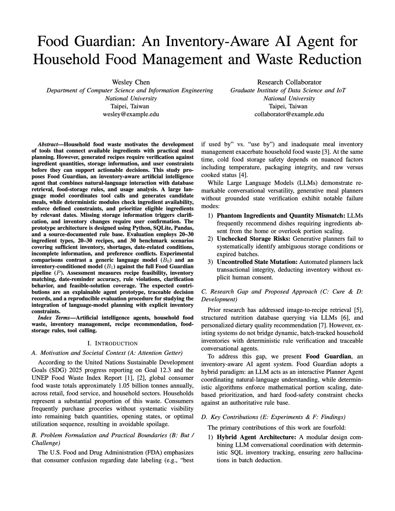
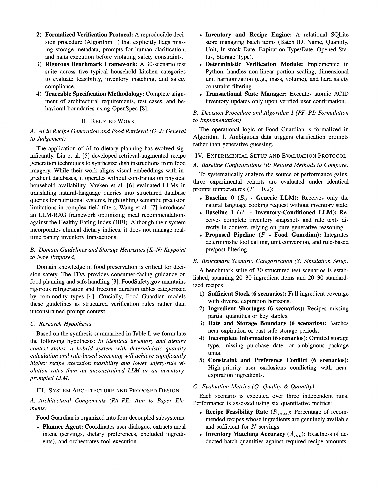
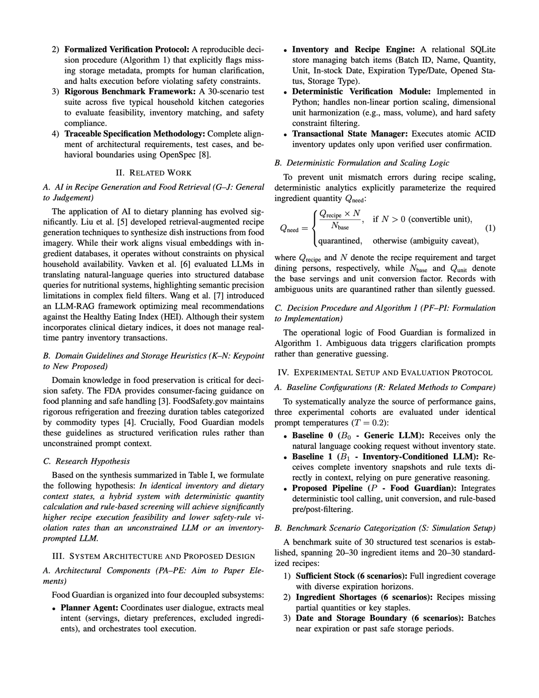
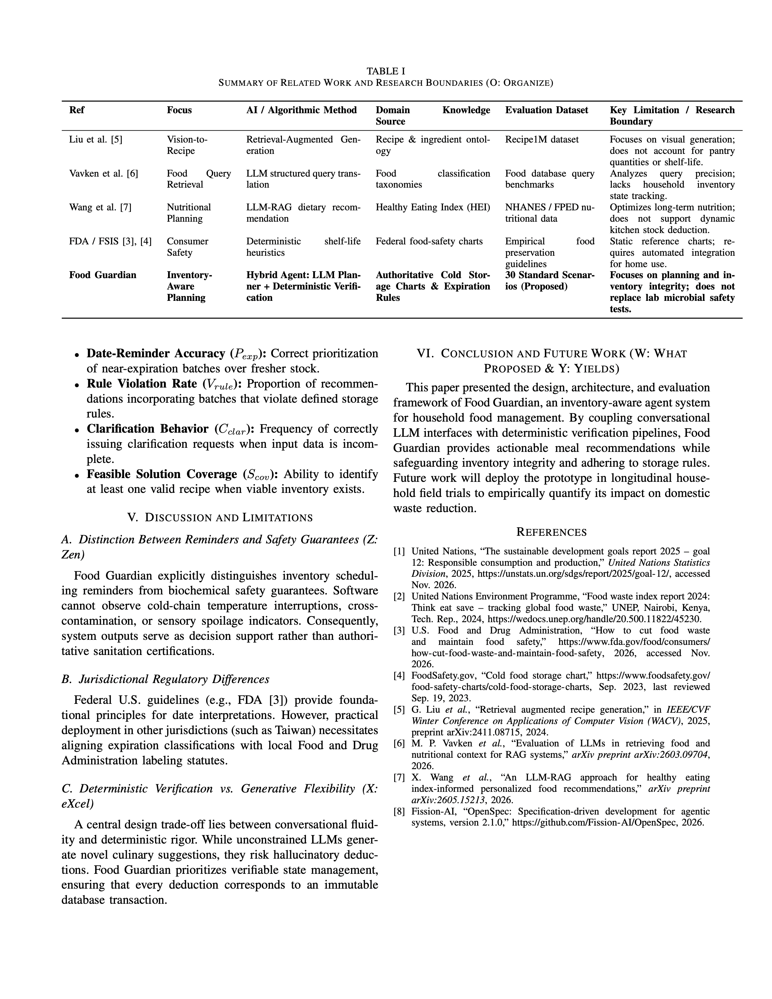
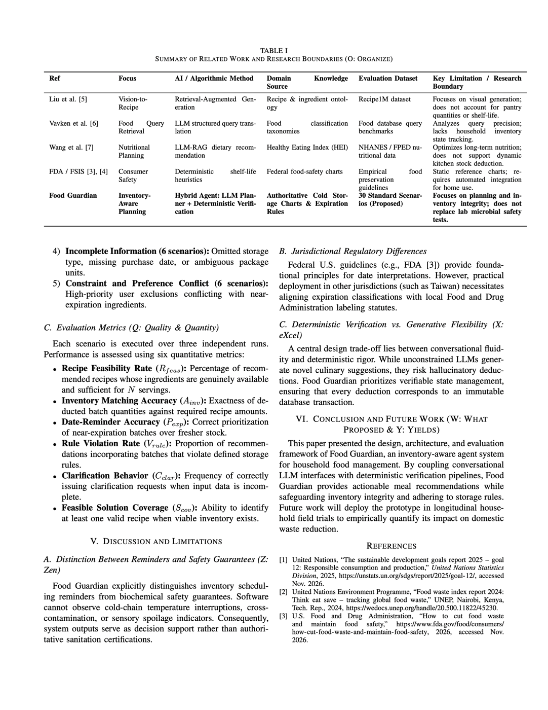
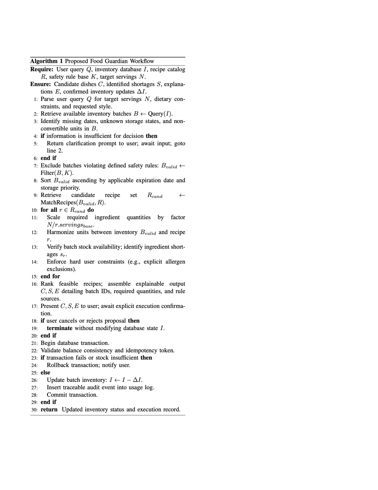
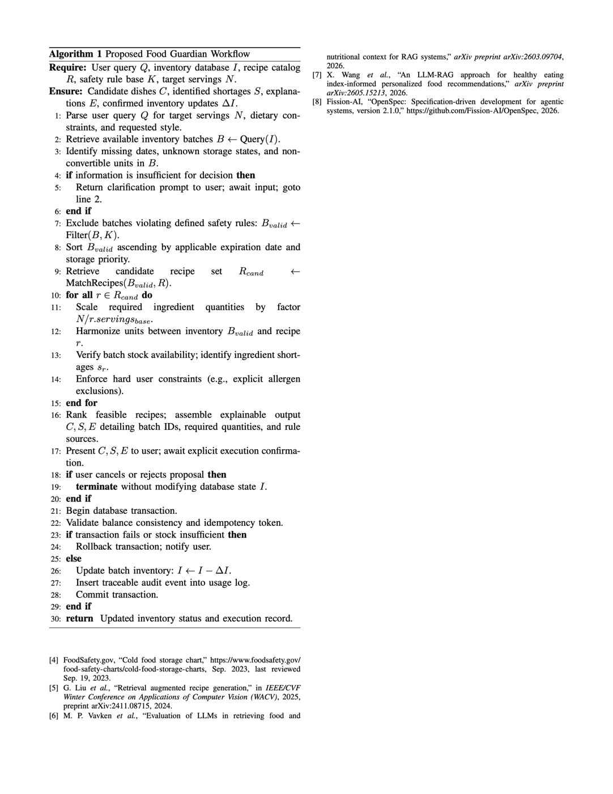

# Food Guardian — DIC4: Overleaf Draft for Conference using MCP and OpenSpec

物聯網數據分析與應用：DIC4 Conference Paper Draft using OpenSpec & Overleaf Sync。
本儲存庫為獨立研究與論文工作區，專注於規格驅動開發（OpenSpec）、IEEE/ICEB 會議論文初稿（Overleaf 同步）與 CI 自動化驗證，不包含實體系統實作與未經證實之實驗結果。

## 作業要求與文件索引

| 要求 | 文件與目錄 |
| --- | --- |
| 1. 安裝 OpenSpec、規格驅動開發 | [操作與驗證流程](docs/openspec-workflow.md) |
| 2. A–F、5 cores、3 trade-offs、10 details | [研究提案整理](docs/proposal-strengthening.md) |
| 3. DESIGN → OpenSpec workflow | [DESIGN.md](DESIGN.md)、[規格庫](openspec/specs/)、[001 變更提案](openspec/changes/archive/2026-11-25-001-refactor-project-proposal/) |
| 4. Introduction refactor | [緒論](docs/introduction.md) |
| 5. Related Work refactor | [相關研究](docs/related-work.md)、[References](docs/references.md) |
| **DIC4. IEEE / ICEB 論文手稿 (Overleaf)** | [ICEB paper/](ICEB%20paper/)、[main.txt](ICEB%20paper/main.txt)、[main.tex](ICEB%20paper/main.tex)、[模組化章節](ICEB%20paper/sections/)、[references.bib](ICEB%20paper/references.bib) |
| **DIC4. A2Z SOP 研究方法論與參考庫** | [myRef/](myRef/)、[A2Z 參考標準](myRef/A2Z%20outline%20example.md)、[A2Z SOP 手冊](myRef/A2Z-SOP-reference.md) |
| **DIC4. 模組化 OpenSpec 規格變更 (000–006)** | [000-abstract](openspec/changes/000-abstract/)、[001-introduction](openspec/changes/001-introduction/)、[002-related-work](openspec/changes/002-related-work/)、[003-proposed-design](openspec/changes/003-proposed-design/)、[004-experiment](openspec/changes/004-experiment/)、[005-conclusion](openspec/changes/005-conclusion/)、[006-reference](openspec/changes/006-reference/)、[write-iceb-paper](openspec/changes/write-iceb-paper/) |
| **DIC4. GitHub Actions CI 自動化驗證** | [.github/workflows/openspec-validate.yml](.github/workflows/openspec-validate.yml) |

## Overleaf ↔ GitHub 雙向自動同步使用方式

本專案支援透過 GitHub 直接同步至 Overleaf：
1. 進入 [Overleaf](https://www.overleaf.com/) $\rightarrow$ **New Project** $\rightarrow$ **Import from GitHub**。
2. 選擇本儲存庫 `Wesley0628c/DIC3`（或 `Wesley0628c/DIC4-overleaf-draft-for-conference-using-MCP-and-openspec`）。
3. 在 Overleaf 專案設定中，**Main document** 選擇 `ICEB paper/main.tex`（或將 `ICEB paper/main.txt` 重命名為 `main.tex`）。
4. 本機每次修改推送至 GitHub 後，在 Overleaf 點擊左上角 **Menu** $\rightarrow$ **Git** $\rightarrow$ **Pull from GitHub** 即可雙向同步。

## 論文版本視覺對比與瑕疵分析 (Flawed vs. Completed Draft Comparison)

本專案提供兩份已編譯 PDF 之完整逐頁高解析度影像，詳細標定論文初稿中的內容結構缺失與排版瑕疵修復成果：

### 對比總覽

| 頁數 | 核心內容模組 | 瑕疵版特徵 (Flawed Draft) | 正常完成版特徵 (Completed Draft) | 排版與學術審查影響 |
| :---: | :--- | :--- | :--- | :--- |
| **Page 1** | Title, Abstract (A–F), Section I | 完整雙欄結構，收錄單段摘要與緒論 | 完整雙欄結構，收錄單段摘要與緒論 | **兩版文字一致**，均符合 IEEE 雙欄格式。 |
| **Page 2** | Section I (E), Section II, Section III | ❌ **缺少數學公式 (Equation 1)**<br>介紹完模組後直接跳到 Algorithm 1。 | ✅ **新增 Subsection III-B 與分段公式 (1)**<br>精準定義份量縮放方程 $Q_{\text{need}}$ 與變數。 | **關鍵形式化修復**：補齊確定性核量與單位模糊隔離之數學依據。 |
| **Page 3** | Table I (Summary Table), Section IV | Table I 置頂，下方硬擠全部 References [1]–[8]。 | Table I 置頂，下方容納 References [1]–[3]。 | **版面自然推移**：正常版文獻自然順延至 Page 4，改善版面密度。 |
| **Page 4** | Algorithm 1, References, Discussion | ❌ **嚴重失衡留白 (Column Underfill)**<br>左欄為 Algorithm 1，**右欄整欄 100% 空白**。 | ✅ **雙欄飽滿平衡 (Balanced Columns)**<br>左欄為 Algorithm 1，**右欄接續 References [4]–[8]**。 | **致命排版修復**：徹底消除 IEEE 審稿嚴禁之大面積空白孤欄。 |

---

### 📄 Page 1 對照：首頁（標題、摘要 A–F、緒論）

| 瑕疵版 (Draft A) | 正常完成版 (Draft B) |
| :---: | :---: |
| [](./assets/paper_comparison/flawed_page_1.png)<br>[🔍 點此檢視原始大圖](./assets/paper_comparison/flawed_page_1.png) | [](./assets/paper_comparison/normal_page_1.png)<br>[🔍 點此檢視原始大圖](./assets/paper_comparison/normal_page_1.png) |

* **排版分析**：Page 1 兩版保持一致，首頁佈局完全遵照 IEEEtran 雙欄規範，收錄完整 Abstract、Index Terms 以及 Section I 的 Motivation、Problem Formulation 與 Key Contributions。

---

### 📄 Page 2 對照：核心架構與數學形式化（關鍵內容差異）

| 瑕疵版 (缺少核心公式) | 正常完成版 (含分段公式 1) |
| :---: | :---: |
| [](./assets/paper_comparison/flawed_page_2.png)<br>[🔍 點此檢視原始大圖](./assets/paper_comparison/flawed_page_2.png) | [](./assets/paper_comparison/normal_page_2.png)<br>[🔍 點此檢視原始大圖](./assets/paper_comparison/normal_page_2.png) |

* **瑕疵版缺陷**：Section III 在介紹完系統 4 大子系統後，直接跳入決策流程與演算法，使得前面宣稱的「確定性份量換算與硬限制檢查」缺乏數學方程式定義。
* **正常版修正**：補齊 **`B. Deterministic Formulation and Scaling Logic`**，以分段方程式形式化：
  $$Q_{\text{need}} = \begin{cases} \dfrac{Q_{\text{recipe}} \times N}{N_{\text{base}}}, & \text{if } N > 0 \text{ (convertible unit)}, \\[10pt] \text{quarantined}, & \text{otherwise (ambiguity caveat)}, \end{cases}$$
  明確定義食譜需求量 $Q_{\text{recipe}}$、用餐人數 $N$、基準份量 $N_{\text{base}}$ 與換算係數 $Q_{\text{unit}}$，奠定後續 Algorithm 1 運行的數學基礎。

---

### 📄 Page 3 對照：文獻比較表與評估設計

| 瑕疵版 (文獻全擠在底部) | 正常完成版 (文獻自然順延) |
| :---: | :---: |
| [](./assets/paper_comparison/flawed_page_3.png)<br>[🔍 點此檢視原始大圖](./assets/paper_comparison/flawed_page_3.png) | [](./assets/paper_comparison/normal_page_3.png)<br>[🔍 點此檢視原始大圖](./assets/paper_comparison/normal_page_3.png) |

* **排版分析**：瑕疵版因 Page 2 缺少公式段落，整體內容提早結束，導致所有參考文獻 [1]–[8] 全數擠在第 3 頁下方；正常版文字自然推進，Page 3 底部收錄 References [1]–[3]，其餘文獻順延至第 4 頁。

---

### 📄 Page 4 對照：演算法環境與結尾排版（最大排版視覺差異）

| ❌ 瑕疵版 (右欄全空，嚴重失衡) | ✅ 正常完成版 (雙欄平衡飽滿) |
| :---: | :---: |
| [](./assets/paper_comparison/flawed_page_4.png)<br>[🔍 點此檢視原始大圖](./assets/paper_comparison/flawed_page_4.png) | [](./assets/paper_comparison/normal_page_4.png)<br>[🔍 點此檢視原始大圖](./assets/paper_comparison/normal_page_4.png) |

* **致命排版瑕疵**：
  * **❌ 瑕疵版**：左欄為 29 行之 Algorithm 1 演算法方塊，**右欄整欄 100% 完全空白**！在 IEEE 會議審稿中，這種大面積空白（Column Underfill）會被判定為排版未達標準。
  * **✅ 正常版**：左欄為完整之 **Algorithm 1**，**右欄自然承接 References [4] 至 [8]**，左右兩欄高度均衡飽滿，完美符合 IEEE 雙欄會議 4 頁滿頁規格。

---

### 相關檔案與下載
* **瑕疵版原始 PDF**：[papers/Food_Guardian...Waste_Reduction.pdf](papers/Food_Guardian__An_Inventory_Aware_AI_Agent_for_Household_Food_Management_and_Waste_Reduction.pdf)
* **正常版原始 PDF**：[papers/Food_Guardian...Waste_Reduction__1_.pdf](papers/Food_Guardian__An_Inventory_Aware_AI_Agent_for_Household_Food_Management_and_Waste_Reduction__1_.pdf)
* **Overleaf 即時匯入壓縮包**：[ieee-food-guardian-overleaf.zip](paper/ieee-food-guardian-overleaf.zip)

## 課堂三部分材料

- 第一部分：[NotebookLM 解析筆記](docs/source-notes.txt)、[A4 資訊圖表 PNG](assets/Food_Guardian_A4_Infographic.png)／[PDF](assets/Food_Guardian_A4_Infographic.pdf)。
- 第二部分：[A–F 與研究補強](docs/proposal-strengthening.md)、[約 300 字中文摘要](docs/abstract-300zh.md)。
- 第三部分：[IEEE 風格英文標題、摘要及關鍵字](docs/abstract-ieee.md)。

解析筆記與舊圖表保留為課堂材料，其中未核實的文獻不作正式論據；正式引用及設計以本版相關研究與 DESIGN 為準。所有實驗數量均為規劃，未宣稱已取得結果。

## OpenSpec 驗證

使用 Node.js >=22.20.0：

```bash
npm ci --prefix tooling
OPENSPEC_TELEMETRY=0 tooling/node_modules/.bin/openspec status --all
OPENSPEC_TELEMETRY=0 tooling/node_modules/.bin/openspec validate --all --strict --no-interactive
```
