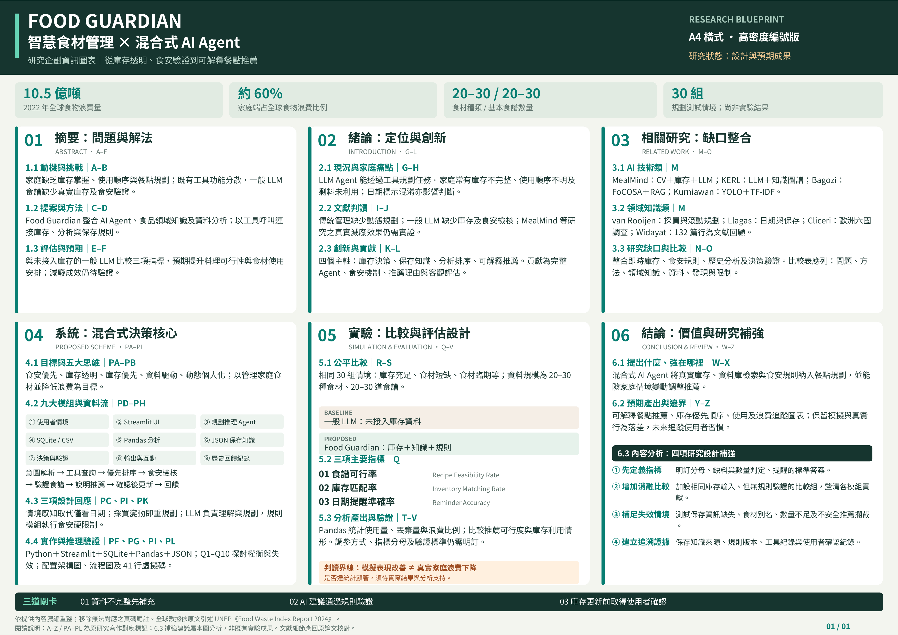

# Food Guardian

## 目前可執行版本（2026-11-17）

已補齊正式提案章節、DESIGN 與 OpenSpec；沿用使用者指定的 MIT 專案模組並修改。可離線管理批次庫存、日期提醒、按人數核對食譜、排除食材、確認使用／丟棄及查看紀錄分析。雲端 Agent 與 RAG 需另行設定；本次沒有雲端模型實測或家庭減廢成效。

- [完整提案入口](docs/proposal.md)：Introduction、Related Work、Deep Research、References。
- [DESIGN.md](DESIGN.md)：架構圖、流程圖、有行號演算法與程式對應。
- [OpenSpec 工作流程](docs/openspec-workflow.md)／[本次變更](openspec/changes/implement-food-guardian/tasks.md)。
- [本機驗證報告](docs/VALIDATION.md)／[仍需補充的資料與工作](docs/remaining-work.md)。
- [參考來源與 MIT 授權](THIRD_PARTY.md)：Chen-Fanny/Food-Guardian，固定 commit e53dfdc。

### 安裝與執行

需要 Python 3.11+。從本專案根目錄執行：

```bash
python3.11 -m venv .venv
.venv/bin/python -m pip install -r requirements.txt
.venv/bin/python -m streamlit run src/ui/app.py
```

一般啟動使用 `data/database/food_guardian.db`，首次為空庫存。想展示 25 種合成食材，先載入另一個示範資料庫：

```bash
.venv/bin/python scripts/seed_demo.py --database data/database/demo.db
DATABASE_PATH=data/database/demo.db .venv/bin/python -m streamlit run src/ui/app.py
```

seed 遇到既有資料會停止，不會重設資料庫。合成日期只作功能測試，不是保存期限建議。實際日期以執行當日計算，正式部署請設定系統時區為 Asia/Taipei。

### Demo 操作

1. 首頁查看庫存與日期提醒；庫存頁可新增、編輯及搜尋。
2. 餐點頁輸入人數、排序及排除食材，查看每項需求量、可用量及缺額。沒有日期的批次需先補資料。
3. 本地聊天可問「推薦兩人份晚餐、有哪些快到期食材、菠菜怎麼保存？」；工具紀錄與執行模式會分開標示。
4. 實際料理後，到庫存頁選擇「已使用」，輸入用量並確認；取消不扣料。丟棄有獨立事件與原因。
5. 統計頁以食材與單位分組，比例只反映已記錄使用／丟棄，不能當成減廢效果。

### 雲端 AI 與 RAG（選用）

將 `.env.example` 複製成 `.env`，填入自己的模型與金鑰。介面預設離線；選擇 OpenAI 或 Gemini 才會送出問題與相關庫存。OpenAI 套件包含於基本安裝；Gemini 使用：

```bash
.venv/bin/python -m pip install -r requirements-ai.txt
```

RAG 另安裝 `requirements-rag.txt`，執行 `scripts/build_rag_index.py` 後設定 `RAG_ENABLED=true`；首次需下載 embedding 模型，本次未驗證該流程。金鑰與個人 SQLite 不可提交到 Git。

### 驗證

```bash
.venv/bin/python -m pip install -r requirements-ai.txt pytest
.venv/bin/python -m pytest tests -q
.venv/bin/python evaluation/run_evaluation.py --output evaluation/results/my-run
.venv/bin/python -m pip check
npm ci --prefix tooling
OPENSPEC_TELEMETRY=0 tooling/node_modules/.bin/openspec validate --all --strict --no-interactive
```

OpenSpec CLI 2.1.0 要求 Node >=22.20.0；本機 Node 22.14.0 的相容警告與實際驗證結果記錄於報告。未安裝選用 RAG 時，其 retrieval 測試會 skipped，不能計作通過。

目前實際資料為 **25 種合成食材、6 道示範食譜、30 組沿用並調整的情境**；原先 20–30 道食譜與 5 類各 6 情境是提案目標，尚未完全落實。本次套件版本見 `requirements-tested.txt`，研究比較與標準答案仍待獨立人工審核。

## 原有提案材料與歷史紀錄

以下保留既有研究構想。舊 PNG／PDF 資訊圖表保留原貌，內含未核實文獻與舊比較設定；本版以正式章節及 DESIGN 為準。圖表提到的 41 行虛擬碼不代表此 repo 具有該原始內容，新版演算法見 DESIGN。


智慧食材管理與家庭食物浪費減量 AI Agent 研究企劃。

本專案提出結合 AI Agent、食品領域知識與資料分析的智慧食材管理系統，整合庫存查詢、臨期食材排序、食譜推薦及保存風險檢查，協助家庭將現有食材轉化為可行餐點。

原有提案材料包含研究摘要、研究補強、IEEE 風格英文摘要、來源筆記及 A4 資訊圖表；本次原型與研究驗證狀態見上方目前版本。

## 第一部分：專題解析與 A4 資訊圖表

依 A–Z 論文架構整理 Food Guardian 的研究動機、挑戰、解法、方法、評估及預期成果，並製作 A4 資訊圖表。

- [NotebookLM 原始解析筆記](docs/source-notes.txt)
- [A4 資訊圖表 PDF](assets/Food_Guardian_A4_Infographic.pdf)
- [A4 資訊圖表 PNG](assets/Food_Guardian_A4_Infographic.png)

原始解析時未取得獨立的《期末專題規範.pdf》，仍需補做規範對照；筆記中的未核實文獻不能直接當作正式引用。



## 第二部分：研究補強與中文摘要

補充官方報告與相關研究，整理 A–F、五大核心、三項取捨、十項設計問答、研究貢獻及可驗證的評估方法，再濃縮為約 300 字中文摘要。

- [完整研究補強與文獻比較](docs/proposal-strengthening.md)
- [約 300 字中文摘要](docs/abstract-300zh.md)
- [原有約 500 字摘要](docs/abstract.md)

研究補強附上來源連結，區分既有證據、研究假設與預期成果；保存規則的臺灣適用性仍須在實作時逐項核對。

## 第三部分：IEEE 風格英文摘要

以英文標題（Title）、單段摘要（Abstract）及關鍵字（Index Terms）呈現 Food Guardian 的研究問題、系統方法、評估規劃與預期貢獻。

- [IEEE 風格英文標題、摘要與關鍵字](docs/abstract-ieee.md)

目前為提案階段，英文摘要使用提案時態，未宣稱已取得實驗結果；正式投稿時需再核對目標期刊的格式要求。

## 規劃技術

| 項目 | 技術或方法 |
| --- | --- |
| 系統開發 | Python |
| 使用者介面 | Streamlit |
| 資料儲存 | SQLite |
| 資料分析 | Pandas |
| 推薦與規劃 | 具 Tool Calling 能力的 LLM Agent |
| 食品保存知識 | JSON 知識庫與規則檢查 |

## 實驗規劃

建立 20–30 種常見食材、20–30 道基本食譜與 30 組測試情境，與未整合真實庫存的一般 LLM 食譜推薦進行比較。評估食譜可行率、庫存匹配率與日期提醒準確率，並分析食材使用量、丟棄量及浪費比例。

## 資料說明

原始筆記保留原貌，其中的文獻名稱與統計不應直接作為已查證結論。第二部分研究補強另附已查閱的官方報告及論文連結，並區分來源證據、研究假設與預期成果。原有約 500 字摘要保留，另提供約 300 字中文摘要與 IEEE 風格英文摘要。

正式 Introduction、Related Work 及 OpenSpec 本次已新增，連結見上方；以下原有比較表保留作研究補強材料。
